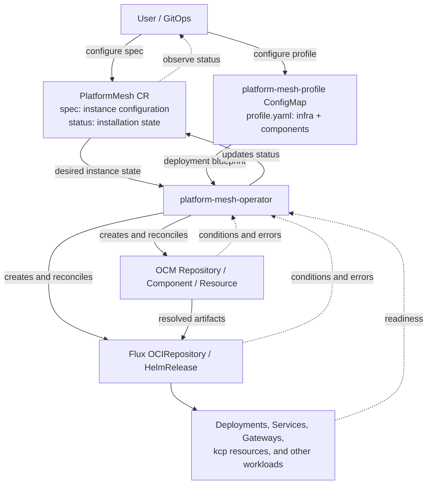

# Platform Mesh installation

This directory documents the declarative Helm installation of Platform Mesh.
The same charts support production clusters and local Kind clusters; only the
commands and target-specific Helm values differ. There are no bootstrap
scripts.

GitHub-flavored Markdown does not support tabs. The command alternatives below
use collapsible sections instead. Choose either **Production** or **Kind** and
use that same target throughout the procedure.

## Requirements

### Software

- `kubectl` and Helm.
- For local Kind: Docker and `kind`.
- Outbound access to the OCI registries from which the charts, Platform Mesh
  OCM component, and container images are pulled.

### Kubernetes cluster

- A Kubernetes cluster and a `kubectl` context that targets it.
- Permission to create namespaces, CRDs, admission webhooks, and cluster-scoped
  RBAC resources.
- A default `StorageClass` that dynamically provisions ReadWriteOnce volumes.
- At least 8 CPUs and 12 GB of RAM available for Platform Mesh workloads.

Platform Mesh requires the following cluster components at the listed versions:

| Component | Version |
|---|---|
| Flux | 2.17.2 |
| OCM controller (ocm-k8s-toolkit) | 0.13.0 |
| cert-manager | v1.20.1 |
| Gateway API CRDs | 1.5.1 |
| Traefik | 41.4.0 |
| Traefik CRDs | 1.14.0 |
| CloudNativePG | 0.28.0 |
| Keycloak operator | 0.10.0 |
| etcd-druid | v0.36.4 |

The `platform-mesh-prerequisites` chart installs all of the above at these exact
versions and is the simplest way to satisfy this requirement. Any other
installation method that provides compatible versions — including cluster-managed
controllers or separately installed operators — works equally well. The cluster
must also expose a `GatewayClass`.

### Production

- A working LoadBalancer integration for the gateway API controller.
- DNS control of the base domain: the apex and `*.<base-domain>` must resolve
  to the gateway controller's LoadBalancer.
- A certificate strategy: use the chart-managed private CA, or create the
  `domain-certificate` Secret before installing the operator.

### Local Kind

- Host port `8443` available for the gateway API controller's NodePort `31000`.
- Sufficient local disk space for the Kind node and Platform Mesh workloads.
- `portal.localhost` is the recommended base domain; browsers resolve its
  wildcard subdomains to loopback.

The installation has two layers:

- `platform-mesh-prerequisites` installs, or can be replaced by, the cluster
  infrastructure that Platform Mesh consumes. See [Requirements](#requirements)
  for the full component list and versions.
- `platform-mesh-operator` installs the Platform Mesh operator (PMO) and a
  `PlatformMesh` resource. PMO then reconciles the Platform Mesh component and
  its services, including the kcp operator.

## How the installation works

The complete Platform Mesh installation is orchestrated by the
`platform-mesh-operator`. The prerequisites chart only supplies the controllers
and CRDs that PMO needs; it does not install the Platform Mesh services.

PMO has two user-configurable inputs:

1. The **`PlatformMesh` custom resource** defines instance-specific settings,
   such as exposure, OCM configuration, feature toggles, and per-instance
   overrides.
2. The **`platform-mesh-profile` ConfigMap** contains `profile.yaml`, the broad
   deployment blueprint. Its `infra` and `components` sections define which
   services are enabled, their deployment settings, dependencies, and base Helm
   values.

The operator merges these inputs, renders its deployment templates, and
continuously reconciles the result. In this installation, the operator Helm
chart creates the initial `PlatformMesh` resource and profile ConfigMap. Keep
their desired configuration in Helm values or in the GitOps source that owns
these two objects.



> [!IMPORTANT]
> Configure Platform Mesh only through the `PlatformMesh` resource and the
> `platform-mesh-profile` ConfigMap. PMO owns generated resources such as OCM
> `Resource` objects, Flux `OCIRepository` and `HelmRelease` objects,
> `Deployment` objects, and their supporting resources. They may be inspected
> for diagnostics, but must not be configured or modified directly. PMO can
> overwrite such changes, and direct edits can leave the installation
> inconsistent with its declared inputs.

The `PlatformMesh` resource's `status` is the source of truth for installation
progress. PMO reports the current reconciliation stage and any errors there,
including transient or expected errors while dependencies are still becoming
ready. A successful installation eventually reports `Ready=True`; when it is
not ready, inspect its conditions and messages before looking at generated
resources:

```shell
kubectl --namespace platform-mesh-system \
  get platformmesh platform-mesh \
  --output yaml
```

If an error persists, correct the `PlatformMesh` spec, the profile ConfigMap, or
the external prerequisite identified by the status. Do not work around it by
patching an operator-generated resource. For the complete input schema and
merge behavior, see the
[platform-mesh-operator documentation](https://github.com/platform-mesh/platform-mesh/blob/main/operators/platform-mesh-operator/README.md).

## 1. Prepare the cluster

Start with an existing production cluster or create a local Kind cluster. The
Kind configuration below maps `127.0.0.1:8443` to NodePort `31000` on the
gateway controller Service.

For a clean repeat of the Kind procedure, remove only the named test cluster
first:

```shell
kind delete cluster --name platform-mesh
```

Use `portal.localhost` for the Kind `base_domain` below. If you select another
domain, configure DNS so the base domain, `kcp.api.<base-domain>`,
`root.kcp.<base-domain>`, and `*.<base-domain>` resolve to `127.0.0.1`.

<details open>
<summary><strong>Production</strong></summary>

Confirm that `kubectl` targets the intended cluster:

```shell
kubectl config current-context
```

</details>

<details>
<summary><strong>Kind</strong></summary>

```shell
kind create cluster --name platform-mesh --image kindest/node:v1.35.1 --config=- <<'EOF'
apiVersion: kind.x-k8s.io/v1alpha4
kind: Cluster
networking:
  apiServerAddress: "127.0.0.1"
  kubeProxyMode: iptables
nodes:
  - role: control-plane
    extraPortMappings:
      - containerPort: 31000
        hostPort: 8443
        protocol: TCP
        listenAddress: "127.0.0.1"
EOF
```

</details>

## 2. Install the prerequisites

Skip this step only when the cluster already provides all components listed in
[Requirements](#requirements) at compatible versions, including a Traefik as a default
`GatewayClass`. Any installation method is acceptable.

The bundled chart is installed in two passes. The first pass establishes the
controllers and CRDs; the second pass enables Traefik after the Gateway API
kinds are discoverable. The commands below pin the prerequisite chart to the
version tested with this guide; upgrade it together with the operator chart and
Platform Mesh component, rather than allowing an unreviewed OCI `latest`
release to change the installation.

<details open>
<summary><strong>Production</strong></summary>

```shell
helm upgrade --install platform-mesh-prerequisites \
  oci://ghcr.io/platform-mesh/helm-charts/platform-mesh-prerequisites \
  --version 0.2.2 \
  --namespace platform-mesh-system \
  --create-namespace \
  --wait \
  --timeout 15m

helm upgrade platform-mesh-prerequisites \
  oci://ghcr.io/platform-mesh/helm-charts/platform-mesh-prerequisites \
  --version 0.2.2 \
  --namespace platform-mesh-system \
  --reset-values \
  --wait \
  --timeout 15m \
  --set traefik.enabled=true \
  --set traefik.service.type=LoadBalancer \
  --set traefik.service.spec.type=LoadBalancer \
  --set traefik.ports.websecure.port=443 \
  --set traefik.ports.websecure.exposedPort=443

until load_balancer_address=$(kubectl --namespace platform-mesh-system \
  get service platform-mesh-prerequisites-traefik \
  --output jsonpath='{.status.loadBalancer.ingress[0].ip}{.status.loadBalancer.ingress[0].hostname}') \
  && [ -n "${load_balancer_address}" ]; do
  echo "Waiting for LoadBalancer address..."
  sleep 5
done

echo "LoadBalancer address: ${load_balancer_address}"
```

</details>

<details>
<summary><strong>Kind</strong></summary>

```shell
helm upgrade --install platform-mesh-prerequisites \
  oci://ghcr.io/platform-mesh/helm-charts/platform-mesh-prerequisites \
  --version 0.2.2 \
  --namespace platform-mesh-system \
  --set keycloak-operator.watchNamespaces=platform-mesh-system \
  --create-namespace \
  --wait \
  --timeout 15m

helm upgrade platform-mesh-prerequisites \
  oci://ghcr.io/platform-mesh/helm-charts/platform-mesh-prerequisites \
  --version 0.2.2 \
  --namespace platform-mesh-system \
  --reset-values \
  --wait \
  --timeout 15m \
  --set traefik.enabled=true \
  --set traefik.service.type=NodePort \
  --set traefik.service.spec.type=NodePort \
  --set traefik.service.spec.clusterIP=10.96.188.4 \
  --set traefik.ports.websecure.exposedPort=8443 \
  --set traefik.ports.websecure.nodePort=31000
```

The fixed `10.96.188.4` ClusterIP assumes Kind's default Service CIDR and must
be unused. It makes the Kind profile's in-cluster host aliases deterministic.
If it conflicts with an existing Service or the cluster uses another Service
CIDR, choose an unused address in that Service CIDR, then pass the actual
Traefik ClusterIP to `gateway.traefikClusterIP` in the next step.

</details>

### Bring your own gateway

Traefik is only the default example controller. Platform Mesh renders standard
Gateway API resources, so any conformant Gateway API implementation (Envoy
Gateway, Istio, Cilium, NGINX Gateway Fabric, …) can serve the landscape. To use
your own controller:

1. Install your Gateway API controller through your own tooling and let it register
   a `GatewayClass`. Install it instead of enabling Traefik — skip the second
   prerequisites pass (`--set traefik.enabled=true`). The Gateway API CRDs still
   come from the `gateway-api-crds` chart (prerequisites pass 1) regardless of
   controller.
2. Point Platform Mesh at that class when installing the operator (step 3):
   `--set gateway.className=<your-gatewayclass>`.
3. For Kind, configure your gateway controller's NodePort Service to use port
   `31000` (matching the Kind cluster's host port mapping). Pass its ClusterIP
   with `--set gateway.clusterIP=<clusterIP>`.

For an example you can see Envoy Gateway setup walkthrough [Running Platform Mesh with Envoy Gateway](../docs/envoy-gateway-class-example.md).

## 3. Configure the domain, certificates, and install Platform Mesh

Set the base domain and desired OCM component version before installing PMO.
The base domain and its wildcard subdomains must resolve to gateway controller address. Production
DNS must point to the LoadBalancer address. The commands pin the operator chart
to `0.61.0`, which was tested with prerequisite chart `0.2.2` and Platform
Mesh component `0.6.0-build.6`; select and test a compatible set when
upgrading.

Choose who manages the domain certificates with
`certificates.selfSigned.enabled`:

- `true` asks cert-manager to create a private self-signed CA and issue the
  domain certificate. The operator chart creates both `domain-certificate` and
  `domain-certificate-ca`. Clients must trust the generated CA.
- `false` disables certificate generation. Before installing PMO, provision the
  `domain-certificate` Secret yourself in `platform-mesh-system`. Use this mode
  for certificates issued by an organisation-managed or publicly trusted CA.

Externally managed Secrets must provide the following data:

| Secret | Required data |
|---|---|
| `domain-certificate` | `tls.crt`: server certificate or full chain covering the base domain and wildcard subdomains; `tls.key`: matching private key; `ca.crt`: issuing CA or trust chain |

When self-signed certificates are enabled, cert-manager creates
`domain-certificate-ca` with the CA certificate and private key; do not replace
that Secret. For externally managed certificates, create or update only the
leaf certificate Secret:

```shell
kubectl --namespace platform-mesh-system create secret generic domain-certificate \
  --type=kubernetes.io/tls \
  --from-file=tls.crt=/path/to/tls.crt \
  --from-file=tls.key=/path/to/tls.key \
  --from-file=ca.crt=/path/to/ca.crt \
  --dry-run=client \
  --output yaml | kubectl apply --filename -
```

Set `self_signed_certificates=false` in the selected installation command when
using these externally managed Secrets.

<details open>
<summary><strong>Production</strong></summary>

```shell
base_domain=platform.example.com
platform_mesh_version=0.6.0-build.6
self_signed_certificates=true
gateway_class_name=traefik
test -n "${base_domain:-}"
test -n "${platform_mesh_version:-}"
echo "Configure ${base_domain} and *.${base_domain} for ${load_balancer_address}"

helm upgrade --install platform-mesh-operator \
  oci://ghcr.io/platform-mesh/helm-charts/platform-mesh-operator \
  --version 0.61.0 \
  --namespace platform-mesh-system \
  --set ocm.enabled=true \
  --set ocm.profile=production \
  --set gateway.className="${gateway_class_name}" \
  --set gateway.baseDomain="${base_domain}" \
  --set gateway.port=443 \
  --set kcp.frontProxyPort=443 \
  --set certificates.selfSigned.enabled="${self_signed_certificates}" \
  --set-string ocm.version="${platform_mesh_version}" \
  --wait \
  --timeout 15m
```

</details>

<details>
<summary><strong>Kind</strong></summary>

```shell
base_domain=portal.localhost
platform_mesh_version=0.6.0-build.6
self_signed_certificates=true
gateway_class_name=traefik
gateway_cluster_ip="$(kubectl -n platform-mesh-system get svc platform-mesh-prerequisites-traefik -o jsonpath='{.spec.clusterIP}')"
test -n "${base_domain:-}"
test -n "${platform_mesh_version:-}"
test -n "${gateway_cluster_ip:-}"

helm upgrade --install platform-mesh-operator \
  oci://ghcr.io/platform-mesh/helm-charts/platform-mesh-operator \
  --version 0.61.0 \
  --namespace platform-mesh-system \
  --set ocm.enabled=true \
  --set ocm.profile=kind \
  --set gateway.className="${gateway_class_name}" \
  --set gateway.baseDomain="${base_domain}" \
  --set gateway.port=8443 \
  --set gateway.clusterIP="${gateway_cluster_ip}" \
  --set kcp.frontProxyPort=8443 \
  --set certificates.selfSigned.enabled="${self_signed_certificates}" \
  --set-string ocm.version="${platform_mesh_version}" \
  --wait \
  --timeout 15m
```

</details>

## 4. Wait for Platform Mesh

If chart-managed certificates are enabled (`certificates.selfSigned.enabled=true`),
wait for the generated certificate first:

```shell
kubectl wait --namespace platform-mesh-system \
  --for=condition=Ready certificate/platform-mesh-domain \
  --timeout=10m
```

Then wait for the `PlatformMesh` resource to become ready:

```shell
kubectl wait --namespace platform-mesh-system \
  --for=condition=Ready platformmeshes/platform-mesh \
  --timeout=30m
```

If either wait times out, inspect the source-of-truth status before changing
generated resources:

```shell
kubectl --namespace platform-mesh-system get platformmesh platform-mesh --output yaml
kubectl --namespace platform-mesh-system get pods
kubectl --namespace platform-mesh-system get helmreleases,ocirepositories
```

For self-signed certificates, save the CA for command-line clients and import
it into the browser or operating-system trust store before opening the portal:

```shell
kubectl --namespace platform-mesh-system get secret domain-certificate \
  --output jsonpath='{.data.ca\.crt}' | base64 --decode > platform-mesh-domain-ca.crt
```

For example, `curl --cacert platform-mesh-domain-ca.crt https://<base-domain>:<port>/`
should succeed. The exact trust-store import procedure is operating-system and
browser specific. Do not bypass certificate warnings in a normal deployment.

Open the Platform Mesh endpoint. For production: `https://${base_domain}`. For Kind: `https://${base_domain}:8443`.

## Organization onboarding

After Platform Mesh is ready, follow the
[organization onboarding procedure](organization-onboarding.md).
